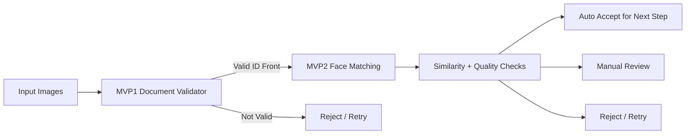

# Graduation Project Documentation
## KYC Validator System for Egyptian National ID Verification

> **Project state:** Internal-testing prototype approaching production-oriented design, not a fully production-ready KYC platform.

---

## Chapter 1 — Introduction

### 1.1 Problem Statement
Ride-hailing onboarding needs fast and safe identity checks. Manual-only checks do not scale well, while fully automated checks can introduce fraud risk if weak decision logic is used.

This project addresses two practical checks:
1. Is the uploaded document likely an **Egyptian National ID front**?
2. Does the selfie holder **approximately match** the portrait on the ID?

### 1.2 Why This Matters
If invalid documents pass early onboarding stages, downstream systems and operations teams handle higher fraud load. In this context, reducing high-risk false accepts is a key engineering objective.

### 1.3 Project Objectives
- Build a document-validation MVP (MVP1) for `national_id` vs `not_national_id`.
- Build a face-similarity MVP (MVP2) for selfie vs ID-portrait matching.
- Add dataset auditing, thresholding, and test UIs to support internal evaluation.

### 1.4 Scope Boundaries
**Implemented:** document classification, face matching prototype, threshold workflows, and Streamlit testing apps.

**Not implemented / deferred:** OCR-based credential matching, backend database verification, liveness detection, full anti-spoofing, manual-review dashboard, and production monitoring stack.

---

## Chapter 2 — System Overview

### 2.1 High-Level Architecture

### 2.2 MVP1 vs MVP2
- **MVP1:** binary document classifier for Egyptian ID front validation.
- **MVP2:** face detection + alignment + ArcFace-style embeddings + cosine similarity decision.

### 2.3 Workflow Variants
- Single-image document validation app.
- Two-image face match app (ID + selfie).
- Single-image selfie-holding-ID app (card localization + document validation + face comparison).

### 2.4 Inputs / Outputs
- **Inputs:** image uploads from internal testing flows.
- **Outputs:** risk-oriented decision states such as reject/retry, manual review, or accept for next KYC step.

### 2.5 Internal Testing Philosophy
The project is intentionally structured for controlled internal testing:
- isolate model behavior,
- audit datasets,
- calibrate thresholds,
- inspect failure cases,
before discussing production deployment.

---

## Chapter 3 — Dataset Engineering

### 3.1 Collection Strategy
MVP1 uses prepared positives (Egyptian ID fronts) and negatives (including FantasyID-derived non-target samples), with explicit audit scripts and reports.

### 3.2 Positives and Negatives
- **Positive class:** Egyptian National ID front images.
- **Negative class:** non-target documents and hard negatives (including FantasyID selections).

### 3.3 Hard-Negative Mining
Hard negatives are samples visually confusing for the classifier (e.g., card-like layouts). They are included to reduce false accepts on lookalike content.

### 3.4 Data Balancing and Auditing
Pipeline scripts support extraction, selection, audit, and class-distribution checks. Training is intended only after audit readiness criteria are met.

### 3.5 Privacy and Legal Constraints
Real KYC image collection for calibration is constrained by consent, governance, and data handling requirements. This limits dataset size and impacts confidence in thresholds.

---

## Chapter 4 — MVP1 Document Validation

### 4.1 Task Definition
Binary classification:
- `national_id`
- `not_national_id`

### 4.2 Model Approach
Transfer-learning-based CNN setup (EfficientNetV2-B0-style) for practical accuracy/runtime tradeoff and faster iteration versus full training from scratch.

### 4.3 Decision Logic
A threshold on `national_id_probability` controls acceptance. The project target emphasizes strict acceptance behavior to reduce risky false accepts.

### 4.4 False Accepts vs False Rejects
- **False accept (high risk):** invalid/non-Egyptian document passes as valid.
- **False reject (operational cost):** valid user asked to retry or review.

In this KYC stage, false accepts are treated as the more dangerous error.

### 4.5 Testing Interface
A Streamlit app is used for fast operator-style testing and visual error inspection.

### 4.6 Current Limitations
- Document-level validation only.
- No OCR field cross-checking.
- No backend identity verification.
- Potential vulnerability to high-quality fake/mock ID visuals.

---

## Chapter 5 — MVP2 Face Similarity Prototype

### 5.1 Workflow
1. Detect holder face from selfie/full image.
2. Extract ID portrait face.
3. Align both faces.
4. Compute ArcFace-style embeddings.
5. Score cosine similarity and apply calibrated thresholds.

### 5.2 Core Components
- SCRFD-style face detection (ONNX inference).
- Landmark-based face alignment.
- ArcFace/InsightFace-style embeddings.
- Cosine similarity scoring.

### 5.3 Threshold Calibration
Runtime can apply calibrated thresholds from evaluation reports instead of fixed static defaults, supporting profile-based operating points (e.g., stable vs accurate).

### 5.4 Quality Handling
Quality gates handle blur/brightness/face-size constraints. Low-quality ID portrait conditions can trigger explicit handling paths (e.g., low-quality face outcome and retry/review behavior).

### 5.5 Limitations and Risks
- No liveness/anti-spoofing.
- Printed-photo/replay attacks remain plausible.
- Performance depends on image quality and calibration data scale.
- This stage indicates acceptance for next step, not full identity proof.

---

## Chapter 6 — System Risks and Limitations

### 6.1 Key Risks
- Fake/mock Egyptian IDs passing visual checks.
- Overfitting to visual shortcuts in small datasets.
- Threshold instability under distribution shift.
- Replay and presentation attacks due to missing liveness.
- Weak performance in blur/low-light/occlusion cases.

### 6.2 Production Readiness Concerns
Current system is not fraud-proof and not deployment-hardened. It lacks core production controls such as continuous monitoring, drift alerts, manual-review tooling integration, and governance workflows.

---

## Chapter 7 — Results and Evaluation

### 7.1 Evaluation Style
Results are currently internal/prototype-oriented, combining quantitative reports and qualitative failure inspection.

### 7.2 Example MVP2 Baseline Findings (Prototype)
From available face-similarity baseline reports:
- Valid scored pairs: 472 (balanced same/different: 236/236)
- ROC-AUC: 0.8002
- At threshold 0.70: FAR ≈ 5.5%, FRR ≈ 77.1%
- At near-1% FAR operating point: FAR ≈ 0.85%, but FRR rises to ≈ 89.8%

These values illustrate a practical tradeoff: tightening false accepts can sharply increase false rejects on a small prototype dataset.

### 7.3 Why Small Datasets Are Not Enough
Small, possibly non-representative datasets do not provide robust production confidence. They are useful for pipeline debugging and threshold trend understanding, not final deployment guarantees.

### 7.4 Current Threshold Behavior
Thresholds behave as risk knobs:
- stricter threshold → fewer false accepts, more false rejects,
- lower threshold → better convenience, higher fraud exposure.

---

## Chapter 8 — Future Work

### 8.1 Planned Extensions
- OCR extraction and credential consistency checks.
- Database-backed identity verification.
- Liveness + anti-spoofing module.
- Stronger monitoring/observability and alerting.
- Model versioning and reproducible evaluation governance.
- Larger, consented, region-relevant calibration datasets.
- Improved face detection/localization for difficult captures.
- Deployment hardening and service-level safeguards.

### 8.2 Engineering Priority Order
1. Data scale/quality and calibration reliability.
2. Fraud-resistance (liveness + spoof defenses).
3. Monitoring and operational controls.
4. End-to-end integration with backend review flows.

---

## Chapter 9 — Conclusion

The project delivered a practical two-stage KYC prototype:
- MVP1 for Egyptian ID front document validation,
- MVP2 for selfie-to-ID portrait similarity scoring.

Main achievements are in system decomposition, dataset/audit tooling, threshold-centric decision design, and testable UI workflows.

Main limitations remain anti-spoofing, liveness, dataset scale, and production operations readiness. The system is best treated as an internal prototype baseline that informs a more secure production roadmap

# mad respect if you reached that far